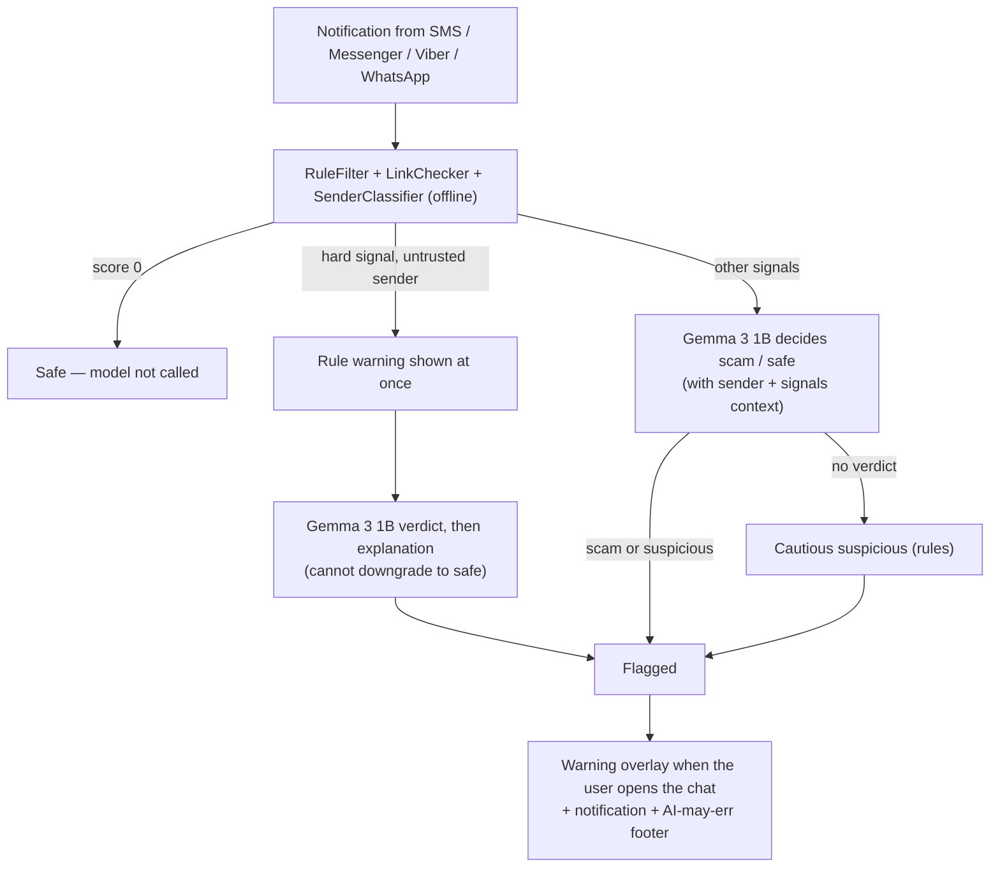

# Technical Architecture & Local AI Pipeline

## 1. High-Level Architecture Overview
Bantai is a native Android app (Kotlin, minSdk 26, targetSdk 35). Every scam check runs on the phone: rule scoring, link checks, sender classification, and LLM inference. The app does not request the `INTERNET` permission.

1. **Notification screening** (`BantaiNotificationListener`, `NotificationExtractor`): a `NotificationListenerService` reads notifications from Google Messages, Samsung Messages, AOSP Messaging, Messenger, Viber, and WhatsApp only.
2. **Layer 1, rules (instant)** (`RuleFilter`, `LinkChecker`, `SenderClassifier`): `RuleFilter` checks 7 signals: money request, new number / impersonation, suspicious link, dangerous link, prize / raffle, account / OTP / parcel, and urgency. `LinkChecker` catches fake brand domains (GCash, Maya, BDO, BPI, Shopee, LBC, SSS, Meralco, and others), URL shorteners, risky domain endings, IP-address links, and lookalike sites. It makes no web requests. `SenderClassifier` labels the sender — official sender ID (curated PH table: telcos, GCash, Maya, banks, couriers, stores), short code, saved contact, mobile number, unverified alphanumeric ID, or unknown — so the model sees who claims to be talking.
3. **Layer 2, on-device LLM** (`ScamPipeline`) — the rules advise, the AI judges:
   - Score 0: safe by rules; the model is not called (the Check tab still consults it).
   - Hard signals — a dangerous link, or new-number + money request together — from a sender that is *not* a saved contact and *not* an official sender ID / short code: the rule warning shows immediately, then the model votes. The model cannot mark it safe.
   - Any other message with signals: the model decides **Scam** or **Safe** (binary verdict — SUSPICIOUS was removed from the prompt because Gemma 1B hedged everything to it; suspicious is an app-layer verdict for contact money requests and cautious fallbacks).
   - No usable model verdict (not loaded, timeout 10 s, error, or no verdict line): a message with signals gets a cautious **Suspicious** ("Bantai couldn't fully check this message") instead of silence; the hard-signal path keeps its rule warning.
   - Saved contact asking for money (with no link, OTP, or prize in the message): marked **Suspicious** instead of Scam, since their account may have been hacked. The warning has a "Call [name]" button that opens the dialer. This uses the optional Contacts permission; contacts are only read on the phone.
   - The model's own reason is shown in the warning. The suggested action comes from app templates, and every warning ends with a reminder that the AI can err and that official senders can be spoofed.
4. **Warning in context** (`BantaiAccessibilityService`, `ScamAlertOverlay`, `ScamNotifier`): an `AccessibilityService`, limited to the same messaging apps, shows the warning overlay next to the flagged message when the user opens the chat. If accessibility is off, the overlay appears right away. A "possible scam" notification is also posted.

### Protection switch (on/off)
**When Protection is OFF, Bantai stops screening messages.** The switch is on the Setup screen and in the Settings tab, and the Home tab shows whether protection is active or paused.
- **OFF:** incoming notifications are ignored. No rule check, no AI check, no new warnings or "possible scam" notifications, and nothing new is added to Alerts.
- **Still works while OFF:** the Check tab (manual checks) and warnings for messages that were already flagged before protection was turned off. Call warnings are paused too, though calls themselves always go through.

### Other features
- **Check tab:** paste any text or link to check it. The model is always consulted here and can override rule flags, except for fake-brand links, which are always flagged.
- **Alerts tab:** history of flagged messages stored on the device, with an audit showing whether the AI model or the rules made the decision.
- **Call warning (Android 10+)** (`BantaiCallScreening`): if Bantai is set as the Caller ID & spam app, it warns on incoming calls from numbers not in contacts. The warning is stronger if that number already sent a flagged text. This uses rules only: no AI, no call audio, and calls are never blocked.
- **Language:** English by default. Tagalog when the app language is set to Tagalog (Settings → Apps → Bantai → Language). The AI's explanation follows the same language.

---

## 2. Local AI Execution Details
- **Runtime:** Google LiteRT-LM `0.18.0` (`com.google.ai.edge.litertlm:litertlm-android`), CPU backend (`LiteRtEngine`).
- **Model:** Gemma 3 1B IT int4 `.litertlm` (`gemma3-1b-it-int4.litertlm`, ~580 MB) only. Qwen3.5-2B was evaluated and dropped: on the Infinix X6811 (Android 11) it took 158 s to load and scored 3/8 with garbled output, versus Gemma's 7.7 s load and 27/30 (0 false negatives, 3 false positives) on the 30-message ground truth.
- **Prompt** (`PromptBuilder`): two-pass prompting (measured ~4× faster for the alert). Pass 1 `buildVerdictPrompt` asks for a one-line `VERDICT: SCAM|SAFE` — two few-shot examples, the sender line from `SenderClassifier`, detected signals, the message (cut to 160 characters); ~5 output tokens ≈ 2–3 s on the Infinix X6811. Pass 2 `buildReasonPrompt` runs only when the verdict is scam and asks for one short `REASON:` sentence in the app's language; the warning already shows while it generates. The old single VERDICT+REASON prompt (`buildScamPrompt`) is kept for the model-only eval.
- **Generation:** max 48 output tokens, temperature 0.2, top-k 10, top-p 0.9. A new conversation is created for each check, so no history carries over. Only one inference runs at a time.
- **Parsing** (`ScamParser`, pipeline internals): pass 1 reads `VERDICT`/`HATOL` (SCAM vs SAFE/LIGTAS); pass 2 reads `REASON`/`DAHILAN`. A reply without a verdict is discarded; the hard-signal path keeps its rule warning, other signal-bearing messages fall back to a cautious Suspicious.
- **Timeout:** 10 s per check (`ScamPipeline.DEFAULT_TIMEOUT_MS`).
- **Data privacy:** message text is only passed to the on-device model. The app has no `INTERNET` permission, so it cannot send data off the phone.

### Model selection (`Bantai.kt`)
Bantai loads Gemma 3 1B when its file is present and the phone reports at least 5,500 MB of real RAM; otherwise it runs rules + link checks only.

---

## 3. Fallbacks & Offline Strategy
- **No internet needed at runtime:** everything runs on the phone. Internet is only needed once before use, to download the model file.
- **Model loading:** a debug build reads the model from `/data/local/tmp/llm/` (pushed with `adb`). A release build bundles the model from `models/` into the APK and copies it to app storage once on first run, since LiteRT-LM needs a real file path.
- **Low-RAM phones:** if the model doesn't fit the phone's RAM, Bantai runs rules + link checks only, so protection stays on.
- **Model failures:** if the model fails to load, isn't ready, times out, or gives no usable verdict, the hard-signal path keeps its rule warning and other flagged messages get a cautious Suspicious rather than silence.
